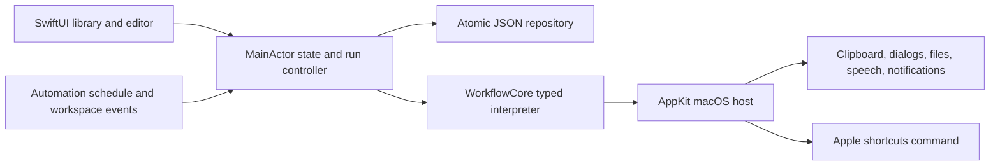

# Shortcut Studio

[](dist/Shortcut-Studio-macOS.zip) [](dist/Shortcut-Studio-Source.zip) [](scripts/Info.plist) [](docs/RELEASE_GUIDE.md) [](VERIFICATION.md) [](docs/ACTION_REFERENCE.md)

## Current checkpoint

[Implementation, evidence, unresolved gaps and ordered investigation](docs/CHECKPOINT_2026_10_14.md). Location automation and recipient-aware messaging are not implemented.

## Android-first local agent

[Native Kotlin foundation](android-agent/README.md), [Google AI Edge Gallery source investigation](research/android-first/GALLERY_SOURCE_INVESTIGATION.md), [model research](research/android-first/MODEL_RESEARCH.md), and [resource contract](android-agent/policy/RESOURCE_CONTRACT.md). The native app is in development: core admission/routing code and a Compose shell exist; no Android APK or on-device inference is qualified yet. The Swift app remains separate.

## Handbook and local downloads

- [Complete handbook](docs/HANDBOOK.md), [offline HTML edition](docs/site/index.html), also bundled under **Help → Shortcut Studio Handbook**.
- [Download app](dist/Shortcut-Studio-macOS.zip), [download source](dist/Shortcut-Studio-Source.zip), [checksums](dist/SHA256SUMS). Local downloads; no public hosting configured.
- [User guide](docs/USER_GUIDE.md), [developer guide](docs/DEVELOPER_GUIDE.md), [Swift APIs](docs/SWIFT_API_REFERENCE.md), [action reference](docs/ACTION_REFERENCE.md), [system construction](docs/SYSTEM_CONSTRUCTION.md).
- [Apple standards audit](docs/APPLE_STANDARDS_AUDIT.md), [privacy](docs/PRIVACY_AND_SECURITY.md), [release guide](docs/RELEASE_GUIDE.md), [comparison](docs/COMPARISON.md).
- [Android messenger gateway](docs/ANDROID_SCOPE.md) and [implementation guide](docs/MESSENGER_GUIDE.md): internet relay, approved Mac workflows, AI only when needed, result inbox and notifications. **Browser companion and test relay implemented; native APK remains future work.**

`WorkflowCore` is an exported Swift library product. See the runnable [EngineClient example](examples/EngineClient/Sources/EngineClient/main.swift).

A native macOS workflow application written in Swift, SwiftUI, and AppKit. It recreates the main Shortcuts authoring model with its own portable workflow engine and provides a supported command-line bridge to Apple's installed Shortcuts engine.

This is version 0.6.0. It is a working implementation, **not complete one-to-one Apple Shortcuts parity**. Apple-only system capabilities and client extensions are explicitly listed below rather than represented by nonfunctional switches. Android Chrome can use the messenger companion. A native Android APK is not implemented.

## Test from Android Chrome

Use **Messenger → Phone Messenger** on the Mac to connect, approve workflows and pair the phone. See [phone test and setup instructions](docs/MESSENGER_GUIDE.md). The hosted gateway is available; a native APK is not implemented. [Create, edit and run phone shortcuts](docs/PHONE_AUTHORING.md). Each owner uses their own Mac library and gateway.

## Open the app

The built application is `dist/Shortcut Studio.app`. Open it in Finder. No dependency installation or cloud account is required. It is signed locally with an ad hoc signature, with hardened runtime enabled; not notarized or Developer ID signed. The build targets macOS 14 or newer; actual build/UI testing was performed on this Mac's macOS 27.0.1 with Swift 6.4. Compatibility with older supported deployment versions has not been measured.

To build and check from Terminal, run inside this directory:

```sh
bash scripts/test.sh
bash scripts/validate-store.sh  # isolated app-store and persistence checks
bash scripts/validate-model.sh  # live on-device checks; requires available Apple Intelligence
bash scripts/generate-reference.sh
python3 scripts/render-handbook.py  # install scripts/requirements-docs.txt only for regeneration
bash scripts/build-app.sh release
```

The test script explicitly registers the CLT-bundled Swift Testing macro plugin when present. The UI uses an explicit alias for the State property wrapper to avoid the newer State macro's absent SwiftUIMacros plugin in this Command Line Tools installation. No SDK was modified.

## Implemented product surfaces

- Native sidebar, colored library cards, grid/list display, folders, favorites, gallery templates, search, and recoverable trash.
- Action editor with parameter forms, multiline text, category/search browser, named variables and action-output reference picker.
- Atomic control-flow editing: moving, duplicating, and deleting an opening block operates on the complete If/Repeat block. Disabled simple actions remain in the editor. Unbalanced blocks are diagnosed before execution.
- Details, persistent Storage, and import Setup questions; icon/color/folder editing.
- Run/Stop, step highlighting, typed output, bounded visible logs, and the last 100 run records.
- Portable `.studio` JSON import/export; version/size/structure validation; import questions; stable identity remapping on duplication/import.
- Apple library discovery and adding an existing Apple shortcut as a Studio bridge workflow; opening the native Apple editor via its supported `shortcuts view` command.
- Six automation presets: time of day with selected weekdays, app activation, app quitting, Mac wake, Mac sleep, and clipboard changes; edit, enable/disable, and test-run controls.

## Action catalog

The current catalog contains 67 action definitions. Each is wired to the independent engine or a macOS host action; external system actions are accessed through Run Apple Shortcut.

| Category | Implemented actions |
|---|---|
| Scripting | Boolean, Comment, Shortcut Input, Set/Get Variable, If/Otherwise/End If, Repeat/Repeat with Each/End Repeat, Wait, Stop and Output, Run Shortcut, Ask for Input, Show Result, Show Alert |
| Text | Text, Change Case, Trim, Replace, Match, Split, Combine, Base64, URL encode/decode |
| Numbers | Number, Calculate, Round, Random, Statistics |
| Lists | List, Count, Choose, Get Item, Sort, Reverse, Unique, Filter |
| Dictionaries | Dictionary JSON, Parse JSON, Get/Set Value, Keys, Convert to JSON |
| Web | URL, HTTP contents, Open URL |
| Files | Select File, Read Text, Save Text, File Details |
| Mac | Desktop File Names, Control Application, Notification, Current/Formatted Date, Clipboard read/write, Open App, Speech, Apple Shortcut bridge |
| Intelligence | Use On-Device Model, Phone Assistant |
| Storage | Get, Set, Remove Stored Value |

The code's catalog is authoritative for titles and grouping; this table groups some related items for readability. Do not interpret 67 as Apple's complete catalog or as 67 independently verified platform integrations.

## Text input and run feedback

Turn on Text Input in the editor to supply multiline UTF-8 text, including empty Text. With the switch off, input is Nothing. Input is kept separately for each shortcut during the session; Run and Command-R use the same configured input. Model prompts and instructions also use multiline editors. Describe a Shortcut offers example prompts, a character count, a draft preview, and explicit Add to Library.

Active action highlighting, scroll following, expanding/collapsing cards, and input expansion use short transitions. Completed actions display checkmarks. These transitions respect the system Reduce Motion preference; the app does not slow the interpreter to create an animation.

## Workflow and value semantics

Values are Nothing, Text, Number, Boolean, List, and Dictionary. An exact reference preserves the referenced type in a parameter. Interpolating a reference into surrounding text converts it to text. The Text action always returns Text. Numbers are finite doubles; lists preserve ordered typed values. A dictionary can contain nested typed values. There are no image, audio, video, location, contact, or custom app-entity types in the independent engine yet.

Reference syntax:

| Syntax | Meaning |
|---|---|
| `{{previous}}` | Previous executed action's output |
| `{{input}}` | Input supplied when the current shortcut starts |
| `{{repeatItem}}` | Current Repeat with Each item |
| `{{repeatIndex}}` | Current loop iteration, starting at 1 |
| `{{variable:Name}}` | Named variable in this run |
| `{{storage:key}}` | Current shortcut's persistent key |
| `{{output:UUID}}` | Specific action's output; picker inserts the identity |

Unavailable variables or outputs fail explicitly. Skipped actions do not supply outputs from earlier iterations. Nested loops restore outer loop context. Each iteration begins with the repeat block's original input, or the current item for Repeat with Each. A completed repeat returns its iteration outputs as a list. Stop and Output exits the current shortcut, including any of its loops. A stop in a called shortcut returns to its caller.

Conditions support has value, equals/not equals, contains, numeric greater/less, and is true. Equality conditions compare text representations; duplicate removal compares typed values. These are Studio semantics, not experimentally proven equivalence to Apple's Content Graph coercions.

Bounds: 10,000 action executions per run, 1,000 repeat iterations/items, 32 authored block nesting levels, 16 nested shortcut calls with recursion rejection, and Wait from 0 to 300 seconds. HTTP requests use a 30-second timeout, require successful HTTP status, and cap read response data at 10 MB. Read Text supports UTF-8 files up to 10 MB. Regex uses Foundation's regex implementation; expensive pathological patterns are not isolated in a separate worker process. The visible output is truncated to 20,000 characters; the engine value remains intact. History output is capped at 4,000 characters and logs at approximately 500 entries.

## Storage and persistence

The library is stored at `~/Library/Application Support/ShortcutStudio/library.json`. This app has its own library and does not edit Apple's database. Saves are atomic. Before replacing a valid library, the prior valid bytes are preserved in `library.json.backup`. A corrupt or unsupported-version library is preserved and blocks normal edits/runs. Restore Backup preserves corrupt bytes under a unique filename before restoring the previous valid document.

Stored values are per-shortcut and commit immediately at Set/Remove Stored Value. Failed storage writes fail the action. Cancellation does not roll back prior committed storage or external side effects. Authoring undo history is cleared when execution starts so it cannot rewind committed runtime values or automation claims. Undo/redo otherwise covers authoring edits and recoverable trash.

Export includes stored values and import questions. Review them before sharing. Run history is local and may contain output from personal workflows. Native `.shortcut` and `.wflow` files are delegated to Apple's app for import; Studio does not decode Apple's signed format or export Apple-compatible files.

## macOS actions and permissions

Prompts, choices, file selection, and saving use native sheets. User cancellation stops the run. Clipboard read/write uses NSPasteboard; URL/app opening uses NSWorkspace, with optional explicit browser bundle selection; speech uses AVSpeechSynthesizer; notifications request system authorization. These actions are genuine system calls, but permission-denied and every platform action have not all been exercised end to end.

Studio is not sandboxed in this local build. Imported workflows can make HTTP requests, read accessible paths, and delegate to existing Apple shortcuts once the user runs them. Review imported actions in the editor. There is no shell-command action or arbitrary native-code evaluator.

The Apple bridge invokes `/usr/bin/shortcuts` with separate argument values, never shell interpolation. Inputs are UTF-8 text files. Text output becomes Text; binary output becomes a dictionary containing Base64 data. Its timeout is 120 seconds. Stop terminates the CLI process, but cannot guarantee that Apple's independently running workflow or already committed actions are undone. Output files use a unique temporary directory and are cleaned up after the bridge call.

## Real example workflows

The verification folder contains importable `Google Search in Chrome.studio` and `Framer to Subframe.studio`. The first opens Chrome and a Google search for Apple Foundation Models Swift. The second opens framer.com in Chrome and launches the installed Subframe app. Both have been run in the native app. These are explicit workflow sequences; manual website visits are not monitored. They require the installed applications identified by their bundle IDs.

## Automation behavior

Automations run while Studio is open. There is no launch agent, system background daemon, or login-item installation. Time triggers support every day or selected weekdays. They poll every 15 seconds, use the current local calendar/time zone, and fire only within 60 seconds of the scheduled time if Studio was already running. Missed days and startup after the scheduled instant are skipped. A claim is saved before launching, so a save failure prevents execution and an app crash after the claim does not automatically replay side effects.

Only one workflow runs at once. Other triggers are skipped when busy; they are not queued. App activation/quitting, wake/sleep, and clipboard events have a 10-second cooldown. A sleep notification does not guarantee a workflow completes before macOS suspends execution. Clipboard changes performed by Studio's own Copy action update the tracked change counter so they do not retrigger that automation. Multiple matching event rules are not all executed: the first eligible match wins. Deleted/missing shortcuts do not run.

## Apple on-device intelligence

Use On-Device Model selects `SystemLanguageModel.default` through Apple's public Foundation Models framework on macOS 26 or later. Each action creates a fresh session with explicit prompt and instructions, no tools, and no cloud fallback. Response snapshots replace the visible output as they arrive; the final text becomes the next action's input. Availability failures and generation errors fail the action explicitly. Cancellation is checked during streaming. Inputs are capped at 6,000 characters, responses at 1,024 tokens; the framework's context and safety limits still apply.

Describe a Shortcut selects an action plan, then generates each step’s parameters with a schema derived from that action. It validates action kinds, parameter keys and choices, action count, locally assigned identities, and block structure. The user reviews the draft and explicitly adds it; adding never executes it. Generated values can still be incorrect or unsuitable and should be inspected before Run. Drafts are limited to 20 actions and 1,500 description characters. Drafting makes two on-device requests; model action text streams. Generated input parameters follow the standard pipeline: shortcut input at the first step and previous output afterward. Richer bindings can be authored in the editor. Model errors do not cause automatic cloud retries.

The app does not select or measure the Neural Engine. Apple controls execution of its system model. An on-device model selection does not prove NPU-only execution, a particular model size, or accuracy for every reasoning task. Regular workflow actions continue through the deterministic interpreter.

## Honest parity boundary

The independent app does not currently implement Apple's entire Content Graph, action catalog, native signed file interchange, Siri/App Intents registration, widgets, Share Sheet extension, Finder Quick Actions, global shortcut registration, iCloud sync, Apple Gallery service, system settings actions, HomeKit/personal iPhone triggers, or privileged private APIs. It also does not provide Apple's full multiple-editor-window behavior or permission/privacy management UI.

For Apple-specific actions already authored in Apple's app, use the Apple Shortcuts library bridge. This is delegation to Apple's runtime, not independent reimplementation. Full standalone parity requires further feature work and reference fixtures, and some system integrations require Apple platform capabilities unavailable to a portable runtime.

## Architecture



`WorkflowCore` holds value models, catalog, interpreter, validation, block editing, persistence, and schedule calculation. `ShortcutStudio` holds UI, platform integration, orchestration, and child-process handling. The runtime checks cancellation between actions and during cooperative waits/network iteration; cancellation does not interrupt an already-running synchronous Foundation regex operation.

See [VERIFICATION.md](VERIFICATION.md) for concrete checks and their limitations.

## Internet setup framework

[Standard Cloudflare onboarding plan](docs/CLOUDFLARE_FRAMEWORK.md): per-owner account authorization, durable gateway, stable link/QR and model/permission readiness. Automatic Workers provisioning and public installer distribution are not implemented in this local release.

### Mac assistant 0.6.0

Folder listing/opening and bounded text reads; phone model on/off; Low Power Mode/thermal gates; app-visible Google and Weather results; semantic New Chat action. Native app interaction requires Accessibility and live verification. [Setup and limits](docs/MAC_ASSISTANT_UPGRADE.md). Named tunnel launcher support is implemented; a permanent gateway is not provisioned.

### Hosted gateway

The single-owner Worker/Durable Object relay is deployed at [the hosted messenger](https://shortcut-studio-messenger.drishti-console.workers.dev). [Migration and evidence](docs/HOSTED_GATEWAY.md). Phone pairing and notifications must be enabled on the new origin; this is not yet automatic provisioning for every installer.

### Mac reminder scheduling

`today at 11am send Good Morning! Lets rock this day` creates a one-time native Mac notification. `every day at 10am send …` creates a daily one. `reminder status` reports pending/delivered requests and notification settings. These explicit commands use no model. Past one-time schedules fail instead of claiming delivery. See [reminder behavior and presentation limits](docs/PHONE_AUTHORING.md#local-mac-reminders).
