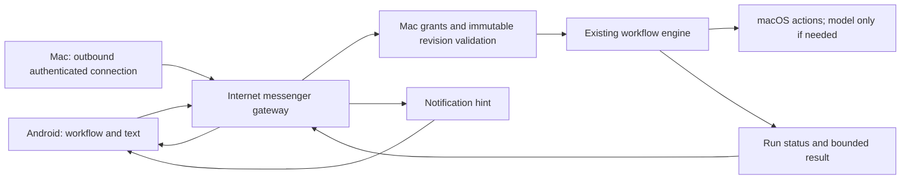

# Android messenger gateway: scope and evaluation

**Status: browser companion, Mac connector and single-owner test gateway implemented in 0.2.0. Native Android and permanent cloud hosting remain future work.** See the [messenger guide](MESSENGER_GUIDE.md) for the runnable subset and its limits. The owner selected an internet-reachable relay and approved Mac workflows, with AI only when a workflow needs it. This replaces the earlier LAN-first controller proposal.

## Command and response architecture

An Android companion sends a message identifying an owner-approved workflow and optional Text input. A gateway authenticates the paired devices, routes the command to an outbound-connected Mac, and returns execution status and the result. The Mac validates its own workflow grants before executing. The gateway is a messenger and delivery coordinator. It has no model inference endpoint and cannot upload executable actions to the Mac.

Apple Foundation Models runs on the eligible Mac only when the chosen workflow contains an on-device model action. Opening Chrome, launching Subframe and deterministic text transformations need no model. A future free-text command selector would require its own explicit scope and review; selecting a fixed workflow does not require AI reasoning.

No inbound Mac port forwarding is required by this design. Both clients connect over authenticated encrypted internet connections. An asleep, offline or stopped Mac cannot execute. Local-network discovery becomes an optional later convenience, with its own OS permission rules.

## Responsibilities

| Component | Owns |
|---|---|
| Android companion | Workflow selection, bounded text, send/stop, readable run conversation, notification preferences and device credential |
| Gateway | Paired routing, expiring delivery records, presence heartbeat, deduplication, bounded event storage, push token lifecycle and rate limits |
| Mac connector | Outbound reconnect, authenticated device identity, command expiry/revocation checks, receipt acknowledgments and run event upload |
| Mac coordinator | Per-phone workflow grants, revision validation, durable acceptance, serialized execution, cancellation and terminal result |
| Existing engine/host | Authored action behavior and permission checks; optional on-device inference |

Gateway receipt means **Sent**, not Mac acceptance. Presence is a recent heartbeat, not a guarantee of immediate execution. The Mac owns the authoritative run journal and authorization; a relay compromise must not grant new execution authority. End-to-end authenticated payload protection between paired phone and Mac is the proposed confidentiality boundary. Select a reviewed cryptographic protocol/library during the transport spike; do not invent cryptography or claim this protection is implemented.

## Notification and conversation UX

- Tap a shared workflow, type input, and Send. Show `Sending → Sent to gateway → Accepted by Mac → Running → Completed`.
- Running shows the workflow name and current safe status. Foreground model output replaces cumulative snapshots, avoiding repeated text.
- Completion card contains the workflow name, readable result, timestamp and **Open result** / **Copy** actions. Opening Chrome can return “Search opened on your Mac”; it must not claim the web page finished loading without a separate observation.
- One Android notification per terminal run, updated under a stable run notification ID. Suggested default: “Shortcut completed — Open to view result.” Sensitive full text stays hidden from the lock screen unless the owner enables previews.
- A notification tap opens the exact authenticated run and fetches the stored result. It never repeats execution. Notification denial leaves results available in the app inbox.
- For long runs, show progress inside the app; avoid token-by-token push notifications. Cancellation displays “Stop requested” until the Mac acknowledges the terminal outcome.
- Mac offline/asleep: show **Mac unavailable**. First version rejects sending for execution when the Mac is unavailable rather than silently running hours later. Commands expire; queueing for later execution requires a separate explicit user feature.
- Needs Local Attention gives a readable reason, such as a Mac permission/dialog, and does not approve it remotely.

Android 13+ requires `POST_NOTIFICATIONS` for ordinary notifications. Request it when the owner enables completion alerts, and respect denial/channel settings. [Android notification permission](https://developer.android.com/develop/ui/views/notifications/notification-permission).

For internet delivery, evaluate Firebase Cloud Messaging as a wake/result-available hint. FCM transport encryption alone is not end-to-end content encryption. Keep prompts and results out of push payloads; authenticated fetch obtains the authorized result. Background execution, force-stop, Doze, token rotation and notification delivery must be tested on actual phones. A push is not an authoritative run receipt or guaranteed real-time wake. [FCM message types](https://firebase.google.com/docs/cloud-messaging/customize-messages/set-message-type), [FCM encryption](https://firebase.google.com/docs/cloud-messaging/encryption).

## First release scope

Owner pairing by a short-lived trusted QR/challenge, per-device grants bound to workflow revision, one-run Mac serialization, Text-only input, status/recovery/stop, expiring commands, bounded result inbox, completion notifications, device revocation, and clear offline/busy/permission/model-unavailable outcomes.

First workflows: input-driven Google search in Chrome, Framer → Subframe, text transformation and an optional on-device summarizer. The existing fixed-query search fixture needs input parameterization. Shared workflows should be noninteractive; file pickers and result dialogs require a remote result adapter or rejection. The gateway cannot bypass macOS permissions, wake a sleeping machine or provide Apple's model on Android.

Native phone action execution, arbitrary shell/file routes, remote workflow import/edit, automatic retries of ambiguous side effects, unattended login-service installation and a general chat-model API are outside this scope. Existing Mac model features remain available locally.

## Pairing and platform APIs

Pair the owner's Android and Mac identities through a single-use expiring challenge and confirmation on the Mac. Store credentials in Android Keystore and Mac Keychain. Bind each message to device, destination, request ID, workflow revision and expiry. TLS validation stays enabled. Refresh/revoke gateway sessions and phone push tokens independently of workflow grants.

Mac: an outbound transport actor, URLSession WebSocket or a reviewed maintained messaging client, Keychain/Security and an awaitable run coordinator. The current app includes an outbound polling connector and browser inbox; native Kotlin remains future work. Android: Kotlin/Compose, lifecycle-aware networking, Keystore, authenticated result fetch and notification channels. [URLSession WebSocket](https://developer.apple.com/documentation/foundation/urlsessionwebsockettask), [Android Keystore](https://developer.android.com/privacy-and-security/keystore), [network security configuration](https://developer.android.com/privacy-and-security/security-config).

LAN discovery, if added later, must follow current [Apple local-network privacy](https://developer.apple.com/documentation/technotes/tn3179-understanding-local-network-privacy) and [Android local-network permission](https://developer.android.com/privacy-and-security/local-network-permission) guidance. It is not required for the internet relay design.

## Failure and evaluation matrix

| Scenario | Required result |
|---|---|
| Unknown/revoked phone or changed workflow | Reject on Mac before execution or private library disclosure |
| Gateway receives but Mac does not accept | Distinct delivery state; no false Running/Completed |
| Duplicate command/event/push | One run, ordered/deduplicated result, one terminal notification |
| Same request ID, different content | Conflict |
| Mac crashes after browser/file side effect | Interrupted/unknown outcome; no automatic replay |
| Mac asleep/offline/busy | Explicit unavailable/busy; expiring command cannot execute later silently |
| Phone background/kill/force-stop/network switch | Results recoverable on reopen; no promise of instant push |
| Notification denied/token changed | Inbox works; token refresh and revocation handled |
| Gateway outage/reconnect/retention expiry | Read-only recovery, explicit expiry, no hidden new run |
| Stop during model streaming | Authorized cooperative cancellation; prior side effects remain |
| Prompt/result confidentiality | No plaintext in push/logs; reviewed payload crypto and actual transport verification |
| Other device's run/history | Denied by both relay routing and Mac ownership checks |

Measure task completion, duplicate external effects, delivery/run latency distributions, result recovery, battery/network overhead and correction effort. No cost, latency, reliability or battery benchmarks have been measured.

## Implementation sequence

1. Mac awaitable coordinator, revision grants and crash/idempotency journal with isolated fixtures.
2. Provider-neutral messenger protocol, pairing and reviewed payload protection; determine hosting/retention/account policy before deployment.
3. Internet gateway plus outbound Mac connector, expiration/presence/recovery fault checks.
4. Android workflow/input/inbox UI and notification permission/push integration.
5. Real-device Chrome/Subframe/model optional paths, then disconnect/revocation/crash/background matrix.

Hosting provider, account enrollment, retention periods, cryptographic library and push service are implementation decisions still open. The owner's approval covers this architecture direction; no internet service has been deployed or third-party account configured.
