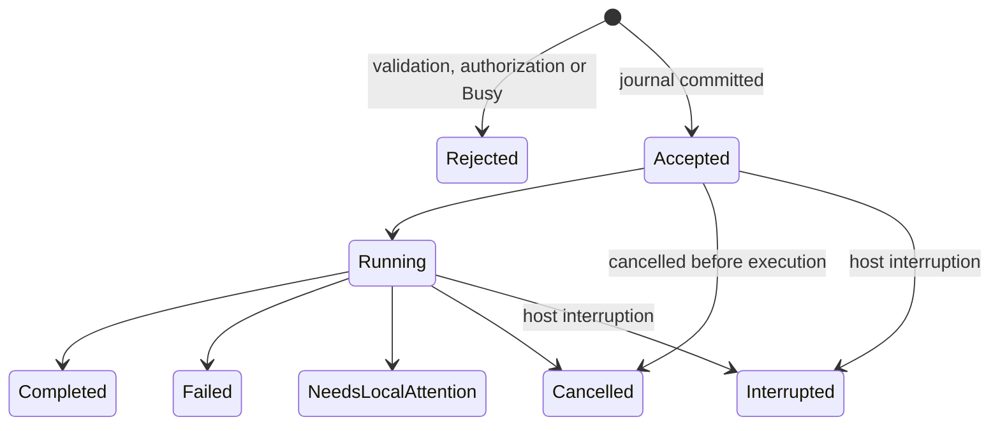

# Proposed messenger gateway command protocol

**Design reference. The runnable 0.2.0 subset is documented in [Messenger guide](MESSENGER_GUIDE.md), including differences in routes, expiry and browser trust.** Version `studio.remote/1` below is a design contract to evaluate. No gateway, Mac connector, Android app or paired device currently implements this contract. The owner selected an internet relay for approved Mac workflows, with AI only when the workflow needs it.

## Transport and pairing

Phone → internet gateway ← outbound Mac connector is the delivery topology. The gateway authenticates routing sessions; the Mac separately verifies paired-device authority and workflow grants. Protect payloads end to end with a reviewed protocol, and keep TLS validation enabled. Gateway receipt is Sent; only a durable Mac acknowledgment is Accepted. Model inference is never performed by the relay.


Use encrypted authenticated connections. Discovery can advertise a service name/protocol version, never a credential. A trusted QR produced on the Mac carries a short-lived single-use high-entropy challenge and the Mac identity fingerprint. Both devices show the same peer identity before the Mac owner confirms pairing. Rate-limit pairing attempts, expire pending challenges, and revoke device credentials from the Mac. Store long-lived material in Keychain/Android Keystore, not workflow JSON, URLs, analytics or logs.

TLS certificate validation must remain enabled. The relay needs a valid server identity; paired devices also need authenticated payload identities. QR trust does not justify accepting every TLS certificate. Evaluate expiry, rotation, identity storage and reconnect behavior in the pairing spike. An account or relay session alone is not a Mac workflow grant. Bonjour discovery is optional and is not required for this internet topology.

## Capability and authorization model

A phone gets a device ID and a set of owner-approved workflow grants, each bound to a workflow revision and capability set. Only granted names/IDs/input descriptions are listed. The phone submits a fixed workflow ID plus Text; it cannot send action definitions, arbitrary paths, code, shell strings, bundle IDs, target URLs or imported files as new execution authority.

A trusted workflow may interpret its bounded input according to its own authored actions, such as encoding a query for a fixed Google endpoint. The Mac validates grants and immutable action configuration first. Changes to actions/parameters invalidate the revision grant. Persisted runtime values are not configuration authorization; resource/destination policy must account for any dynamic values used by a shared workflow.

Only the caller that owns a run, or the Mac owner, can read/cancel it. Remote MVP workflows reject interactive actions or return Needs Local Attention. Apple CLI delegation is excluded until a selected prompt-free integration is individually evaluated; it cannot be assumed noninteractive from a name/UUID.

## Logical route proposal

These logical operations are mediated by the gateway and mapped to the outbound Mac session; they are not public Mac HTTP ports. Relay administration and device revocation require separate authenticated owner operations. The gateway never supplies new workflow configuration.

| Route | Contract |
|---|---|
| `GET /v1/capabilities` | Authenticated protocol/host state, input limits, model availability if shared; no full system/library dump |
| `GET /v1/workflows` | Only this device's grants; current revision and input description |
| `POST /v1/runs` | Validate and persist acceptance, then execute once or return Busy/Conflict/etc. |
| `GET /v1/runs/{runID}` | Authorized current/terminal status for recovery after disconnect |
| `GET /v1/runs/{runID}/events` | Run-scoped events with resumable sequence numbers; transport framing chosen in spike |
| `POST /v1/runs/{runID}/cancel` | Idempotent cancellation request for an owned active run |
| `DELETE /v1/devices/{deviceID}` | Mac owner management; not an unauthenticated phone route |

No general `/execute-code`, `/shell`, `/open-any-url`, `/read-file`, `/import-workflow` or `/all-history` route belongs in the MVP.

## Run request example

```json
{
  "protocol": "studio.remote/1",
  "requestID": "6785e6b3-c99f-4bc1-9a56-b115c49a8925",
  "deviceID": "owner-paired-device-id",
  "clientSequence": "42",
  "destinationMacID": "paired-mac-id",
  "expiresAt": "2026-10-13T12:01:00Z",
  "workflowID": "owner-granted-workflow-uuid",
  "workflowRevision": "sha256-of-canonical-action-configuration",
  "input": { "type": "text", "value": "Apple Foundation Models Swift" }
}
```

Authentication is supplied by the established channel/credential, not trusted merely because `deviceID` is in the body. A sequence is an integer string to avoid JSON/JavaScript precision ambiguity. Define the revision hash precisely over canonical configuration; exclude output/history, and do not hash an unstable Swift object description.

MVP input is Text only, bounded to 16 KiB UTF-8, with smaller workflow/model limits still enforced. The complete request body is bounded to 32 KiB. Reject unknown keys, unsupported protocol/type, invalid UUID/revision/sequence and illegal encodings. JSON-to-`WorkflowValue.text` is an explicit adapter. The remote format is not the synthesized Codable enum used by `.studio` files.

## Acceptance, idempotency and failure

The gateway enforces size, session, routing and expiry limits, assigns delivery states and retains only bounded expiring records. The Mac checks expiry again at execution acceptance. Clock-skew tolerance, heartbeat age, command TTL and retention are explicit implementation parameters to evaluate. Offline/busy runs are not queued for later automatic execution in the first release.

1. Authenticate and authorize before listing details or parsing content beyond safe bounds.
2. Check device revocation, workflow identity/revision, capability policy and app/run availability.
3. Atomically journal the device/request ID, exact request digest, monotonic sequence and Accepted state before invoking the engine.
4. A repeated identical ID returns the original run/result. Same ID with a different body is a conflict.
5. After restart, a previously accepted/running run with no terminal record is Interrupted. Do not replay it automatically.
6. Publish a terminal state and bounded result atomically with the journal as far as the chosen storage design permits.

This does not guarantee mathematically exactly-once external effects. An app/browser/server action can commit immediately before a crash and before the result journal commits. The contract protects against automatic duplicate retries and exposes ambiguous interruption. The user deliberately requests a new run after reviewing that outcome.

Journal retention/sequence rollover/storage limits must be specified before implementation. Persist a device's accepted sequence so expiring terminal records does not make an old command new again. Recoverable lookup needs a documented retention window; unknown/expired requests require an explicit new request, not transparent resubmission. Proposed policy numbers must be tested, not presented as calibrated threat thresholds.

## States and output events



A cancellation acknowledgment means the request was accepted, not that committed side effects were reversed. Terminal states can include stable error codes and a sanitized explanation. Do not leak raw stderr, arbitrary local paths or another workflow's logs to the phone.

Example cumulative model event:

```json
{
  "runID": "owned-run-id",
  "eventSequence": "7",
  "kind": "outputSnapshot",
  "output": { "type": "text", "value": "A concise summary so far..." }
}
```

The phone replaces the previous snapshot; it does not concatenate. Resumable event sequence and bounded final lookup prevent duplicate text and avoid rerunning when an event connection drops. Authenticate the event subscription and filter ownership before sending. The existing global `@Published output` is not directly suitable for this contract.

## Stable error vocabulary to evaluate

`NOT_PAIRED`, `DEVICE_REVOKED`, `WORKFLOW_NOT_GRANTED`, `REVISION_CHANGED`, `BUSY`, `INPUT_TOO_LARGE`, `PROTOCOL_UNSUPPORTED`, `REQUEST_CONFLICT`, `REQUEST_EXPIRED`, `LOCAL_PERMISSION_REQUIRED`, `MODEL_UNAVAILABLE`, `HOST_INTERRUPTED`, `ACTION_FAILED`, `CANCELLED`.

Do not turn all errors into retries. Permission/authorization/conflict/interruption require an explicit user or owner action. Status recovery is read-only; execution requires a distinct accepted command.

## Notification contract

Push contains a bounded opaque run/result-available hint, never the model prompt or result. A notification tap performs authorized result lookup and cannot trigger execution. Deduplicate pushes and update a single notification keyed by run ID. Default lock-screen wording hides sensitive content. Notification denial or delayed delivery does not change execution state; the inbox recovers results on next foreground connection. Foreground streams are cumulative snapshots; only terminal states normally trigger a completion alert.

The run journal is the authority. Push delivery, a gateway acknowledgment and a model token are not proof of completed workflow execution. Stable progress phases include Sending, Sent, Accepted, Running and terminal results. Gateway expiry before Mac acceptance is DeliveryExpired; accepted commands recover from the Mac journal and are never resubmitted as new runs automatically.

## Platform enforcement and privacy

Android notification permission/channels, push token lifecycle, background restrictions, TLS/Keystore/Keychain, payload authentication, secret redaction and relay outages require real-device tests. The gateway creates a new service/privacy boundary: disclose metadata, retention and operators before release. End-to-end payload protection does not hide device identifiers, routing times or traffic sizes from the relay.

No listener or model API is exposed on the Mac. A relay does not make an asleep Mac execute or give Android access to Apple's private APIs. References and the acceptance matrix are in [Android scope](ANDROID_SCOPE.md). No implementation should be declared complete until the intended-device tests pass.
