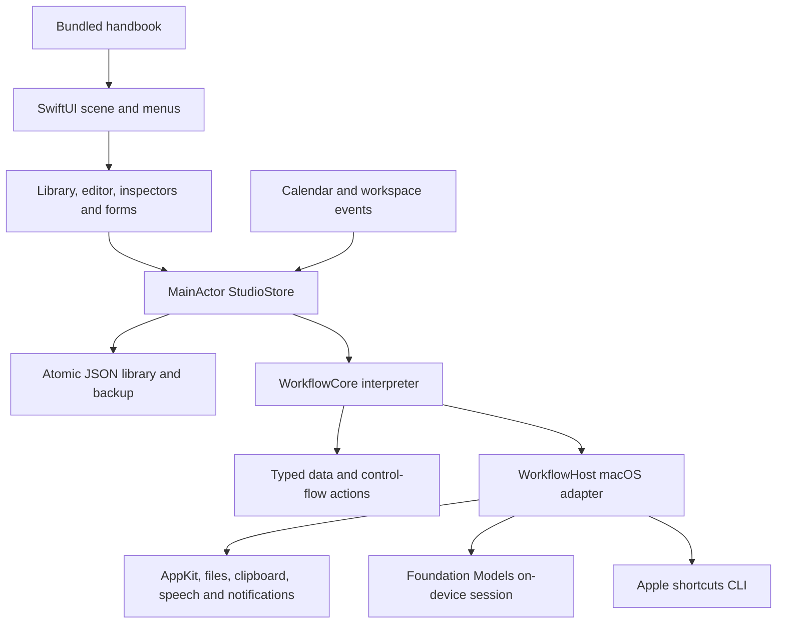
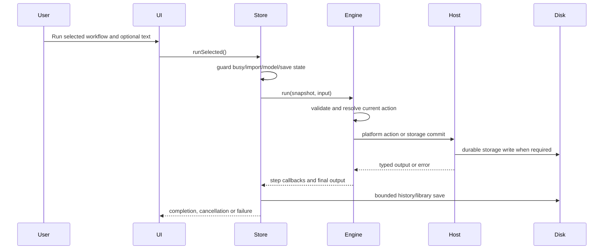

# How the system was constructed

This is a reproducible engineering record of the current macOS application. It is a functional recreation of an authoring/runtime pattern using public APIs, not a claim that Apple's private implementation, model weights, or complete catalog were reconstructed.

## Starting point and research

The project began with REA references and investigation of Shortcuts, Pages, Keynote, Numbers, and Image Playground. Research dossiers live in the workspace's sibling `research/` directory. They document capability boundaries and evidence separately from this app. They are not dependencies or proof that those applications were reimplemented.

The implementation uses Swift, SwiftUI, AppKit, Foundation, and public Foundation Models APIs. REA and private Apple frameworks are not linked. Reading an installed SDK interface established available declarations; no SDK file was modified. The app has its own name, workflow-node icon, library, portable file type, and interpreter.

## Architecture

## Implemented construction sequence

| Stage | What was built | Evidence / limitation |
|---|---|---|
| Research | Public capabilities, APIs, format and permission boundaries | Dossiers and primary references; not full private-engine equivalence |
| Models | Value enum, action IDs, workflows, export/library envelopes | Codable round trips and fixtures; tagged enum storage |
| Interpreter | References, If/Repeat blocks, budgets, nested workflow calls | Named core tests; some synchronous work remains on MainActor |
| Catalog | 64 definitions, forms, choices, defaults, starter workflows | Generated action reference and JSON inventory |
| Authoring | Native library/editor, inspectors, atomic block edits, undo, trash | UI observations and block/reference tests |
| Persistence | Atomic writes, previous-valid backup, preserved corrupt files | Corruption/import/version/schedule tests |
| macOS host | Dialogs, app/URL opening, clipboard, files, speech, notifications | Real examples and selected UI tests; not every permission path tested |
| Apple bridge | Discovery/editor/run via public CLI, typed/bounded output | Isolated text-only Apple fixture passed |
| Automation | Daily/weekday schedule, app activation/quitting, wake/sleep, clipboard | Pure schedule checks and real quit event; no unattended daemon |
| Intelligence | Availability, streamed text, guided two-pass drafts | Live inference, exact-output fixtures, UI acceptance/run, cancellation |
| UI acceptance | Multiline input, keyboard Run, progress, preview, editor state isolation | Native observations and isolated store checks |
| Standards pass | Button-based cards, accessible labels, menu parity, contrast palette, formal UTI, privacy/help bundle, distinct icon, compact layout | Local implementation and packaging checks; remaining audit gates documented |
| Android messenger | Browser client, authenticated test relay, Mac grants, encryption and inbox implemented | Native APK and permanent hosting remain future work |

## Runtime sequence

Cancellation is cooperative and side effects are not transactional. Persisting storage or opening an application can precede a later cancellation. In contrast, a failed storage commit fails the action before its value is treated as committed.

## Format lineage

- `LibraryDocument.schemaVersion`: 1, including workflows/folders/rules/history.
- `.studio` export format: `studio.shortcut`, version 1, containing one workflow.
- Document UTI: `tools.shortcutstudio.workflow`, conforming to `public.json`.
- Native Apple file formats remain owned/handled by Apple.
- The proposed Android wire protocol is a new versioned contract, not a serialized library database or raw Swift enum.

## Design decisions

| Decision | Reason | Cost / consequence |
|---|---|---|
| SwiftUI + AppKit | Native Mac controls, lifecycle, sheets and system actions | Apple-platform host and SDK dependency |
| Independent WorkflowCore | Inspectable behavior, source extension and tests | Limited catalog and custom coercion semantics |
| MainActor engine/host | Simple UI/platform coordination and one-run ownership | Regex/large synchronous work can block UI; future worker separation needed |
| Explicit budgets | Bound loops, calls, steps and input/output sizes | Some legitimate long workflows are rejected |
| Own JSON envelope | Human-readable, versioned workflows and development fixtures | No Apple signed-format interchange |
| Public `shortcuts` CLI | Reuse installed Apple capabilities without private APIs | Delegated permission/execution/cancellation boundaries |
| Immediate storage commits | A successful write has explicit durable semantics | Undo/cancellation cannot rewind runtime effects |
| Local model only | Explicit on-device execution path and availability | Eligibility/context/safety/accuracy limits; no hidden cloud rescue |
| Two-pass model drafting | Action-specific parameter schemas reduce malformed output | More inference work, bounded pipeline expressiveness, still needs review |
| App-open automation | No unexpected service installation or privileges | No execution when Studio is quit/asleep; busy triggers skipped |
| Independent branding | Clear ownership and distinction from Apple's app | Original icon and product positioning need ongoing design review |
| Internet messenger gateway | Owner selected commands across networks, approved Mac workflows and result notifications | Outbound Mac connector, relay operations, pairing, privacy and phone lifecycle require implementation |

## Faults found and repaired

- Native result sheets initially failed when the main window was unavailable; parent resolution was expanded.
- Loop branch outputs could become stale across iterations; per-iteration output identities are cleared and context restored.
- Arithmetic and rounding overflow are rejected explicitly.
- Corrupt data is preserved and cannot silently replace the last known-good backup.
- Authoring undo could rewind runtime state; run start clears undo snapshots.
- AI drafts invented references, shortened literal values, or reused original input. Strict reference checks, per-action schemas and guided pipeline wiring were added.
- Preset forms captured initial state incorrectly; configuration moved into its own initialized view.
- Keyboard Run originally bypassed editor input; the store now owns per-workflow input and one shared runSelected path.
- Output from another selected workflow was misleading; output/logs are selection-scoped.
- Native sheet sizing collapsed the generated action preview; fixed height and width were added and visually checked.
- Library selection originally used tap gestures; native buttons now support keyboard activation.

These fixes are supported by source, named tests, or UI observations. They are not evidence of every possible crash/error path being absent.

## Rebuild the entire local deliverable

Run core/store/model checks, the external Swift example, reference generation, handbook rendering, packaging and artifact validation. The release script bundles the executable, icon, Info.plist, privacy declaration and offline handbook, signs with hardened runtime, creates app/source ZIPs and checksum/provenance files. No user's application-support library or credentials are packaged.

Current limitations and public distribution gates are in [Apple standards audit](APPLE_STANDARDS_AUDIT.md). The path from Android is in [Android scope](ANDROID_SCOPE.md). [Comparison](COMPARISON.md) identifies where engineering control may be useful without overstating superiority.

## Messenger implementation, 0.2.0

The owner chose internet command delivery and approved Mac workflows with AI only when needed, then approved a Chrome phone companion for the first test. The implementation adds a separate Node relay, mobile web UI, Web Push service worker, Swift CryptoKit/Keychain connector and a native pairing/grant sheet. It reuses the existing interpreter through an explicit run callback. A bounded allowlist excludes private reads and interactive/delegated/nested actions; Show Result becomes a phone result. An isolated integration harness checks the actual connector and Web Crypto client against a separate test relay and temporary library, avoiding user keys and workflows. See [Messenger guide](MESSENGER_GUIDE.md).
