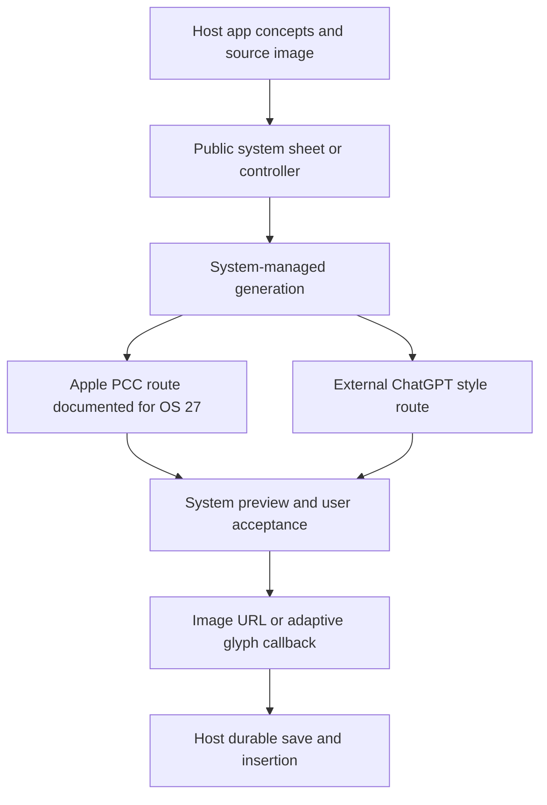

# Image Playground: generation, calls, delivery, device/cloud routing, and faults

Date: 13 October 2026. Reference host: macOS 27.0.1, build 26A434. Status: installed static artifacts, public SDK contracts, official documentation, and limited live UI observation. Generation, model execution, and network capture were not performed.

## 1. Evidence boundary and installed reference

Image Playground is present at `/System/Applications/Image Playground.app`, despite the initial assumption that the requested apps were absent. Its identifier is `com.apple.GenerativePlaygroundApp`, marketing version `1.0`, build `198.0.502`. The bundle declares a generative-model device capability and URL schemes `imageplayground.open` and `imageplayground.open-image`. These declarations do not establish a complete URL grammar or runtime eligibility.

The executable declares dependencies on public `ImagePlayground.framework`, private `ImagePlaygroundInternal.framework`, AppKit, SwiftUI, and other libraries. Included extensions expose App Intents, Messages integration, and diagnostics. Links establish dependencies, not which methods execute for a request.

Local evidence is preserved in `evidence/image-playground-local-inventory.json`, with executable/source hashes, paths, metadata, dependencies, and resource inventory. The installed macOS 27 SDK's public arm64e interface is preserved as `evidence/image-playground-sdk.swiftinterface`. It is an API declaration, not Apple's implementation code.

Evidence labels: STATIC for installed artifacts; OBSERVED for UI; DOCUMENTED for public sources; PROPOSED for our recreation architecture and experiments; UNKNOWN for internals without direct evidence.

## 2. Observed user experience

OBSERVED: the app opens to an empty gallery. New Image opens an editor with an Any Style selector, an empty prompt field, Add Photo, Add Person, Change Aspect Ratio, and a Submit control disabled while the prompt is empty. Share/Delete are disabled without a saved selection. No prompt was submitted, no photo/person was selected, and no suggestions or access settings were changed. New Image is an editor state, not proof that a generation request has succeeded.

DOCUMENTED: the current Mac help describes text/photo/person input, aspect ratios, Apple Intelligence and ChatGPT style choices, natural-language refinements, targeted edits, grouped versions, and automatic gallery saving [I1]. An older regional page described a seven-element concept workflow and explicit Save. Those older rules must not be imposed on the macOS 27 reference. The current page allows up to three people, but that is a documented product limit rather than a measured SDK parameter limit.

PROPOSED research model: a gallery entry contains an idea/session identity and version history. An editor owns prompt, source references, style, aspect ratio, selected version, and generation state. Output acceptance, saving, and insertion into another app are separate lifecycle events. Exact storage format, version branching, autosave timing, and undo semantics remain UNKNOWN.

## 3. Versioned execution routes

| Route | Evidence | What can be stated | What remains unknown |
|---|---|---|---|
| Original Apple Image Playground generation | WWDC24 [I2] | Apple described the model as running locally on device | Historical model binaries, scheduler and each style's later behavior |
| macOS/iOS 27 Apple image generation | WWDC26 [I3] | New generation is described as running on Private Cloud Compute | Exact routing decisions and a trace of a request on this Mac |
| ChatGPT external styles | Mac support [I4] and local provider resource | Apple documents a ChatGPT-backed style path | Private endpoint, payload and streaming protocol |
| Genmoji/adaptive glyph output | SDK declares an adaptive glyph callback | Different output representation from a simple image URL | Every mode's backend and runtime behavior |

DOCUMENTED: WWDC26 describes the move to PCC, new image styles/sizes, system-managed usage limits, and deprecation of ImageCreator. It says an accepted result is returned as a temporary file URL that must be saved elsewhere before the session ends [I3]. These are source claims, not locally measured latency or output quality.

A supported Apple device can still be required for a cloud feature. Hardware eligibility does not imply local inference. A local UI, local result file, or GPU activity also does not establish that the entire generation ran locally. Conversely, observing a network request does not prove it carried an image inference job; it might be asset, account, telemetry, or gallery traffic.

## 4. Current public calls: host application to system UI

STATIC: the SDK declares SwiftUI `imagePlaygroundSheet` overloads accepting an `isPresented` binding, text concept(s), an optional source image or source-image URL, completion callback, and optional cancellation callback. Some overloads also deliver `NSAdaptiveImageGlyph`. These declarations corroborate the public framework guide [I5].

A current integration sequence is:

1. Check availability using a symbol actually present in the target SDK.
2. Assemble concepts and optional source image; configure style and options.
3. Present the system sheet/controller on the UI actor.
4. The person explores generation within the system UI.
5. On acceptance, receive the image URL or supported adaptive glyph callback.
6. Copy the output into durable app storage, then insert/display it.
7. On cancellation, dismiss or restore the application's pre-session state.

The host application is not given a documented HTTP endpoint or API key for Apple generation through this API. The system manages the interaction. Callback execution is a public integration boundary, not an exposed model or transport stream.

STATIC: `ImagePlaygroundViewController` is a MainActor AppKit controller on this SDK. Its properties include `concepts`, `sourceImage: NSImage?`, `delegate`, `options`, `allowedGenerationStyles`, and `selectedGenerationStyle`. The delegate declares `didCreateImageAt`, optional adaptive glyph delivery, and cancellation. `isAvailable` is also declared. UIKit documentation may show `UIImage`; that is not the Mac source-image type [I6].

### Availability discrepancy found during fault checking

The WWDC26 sample uses an environment property named `supportsImageGeneration`. The installed ImagePlayground SDK interface exposes `supportsImagePlayground`, and a scoped search of the installed ImagePlayground, SwiftUI, and SwiftUICore interfaces found no `supportsImageGeneration`. The sample and SDK must not be copied together blindly. Record this as a source/SDK mismatch; use a confirmed SDK property or `ImagePlaygroundViewController.isAvailable` when later implementing. No app was compiled to verify runtime availability in this pass.

## 5. Options, styles, and personalization

STATIC: concepts can be text, extraction from text with an optional title, drawing, image data, or an image URL. Styles include any, animation, illustration, sketch, emoji, and externalProvider, with version availability annotations. Treat animation as a style name; it does not establish that the result is a time-based animated GIF/video.

STATIC: `ImagePlaygroundOptions` exposes creation variety, personalization, creation strategy, and requested size. Variety has automatic/high/low cases; personalization has automatic/enabled/disabled cases; strategy has automatic/editExisting/generateNew cases. Size uses `closest(to:)`, not an exact resolution guarantee.

DOCUMENTED: creation strategy controls how an input image informs generation; personalization can use additional appearance sources, and disabling it uses supplied prompts and starting image [I7, I8]. These controls are not a documented random seed, diffusion-step count, guidance scale, or guarantee of identity preservation. No public raw model controls of that kind were established by this research.

Faults to account for: stale source-image URLs, unsupported image encodings, source images too small for the relevant operation, style availability changing by OS, inconsistent prompt/photo identity, options unsupported by a deployment target, and result dimensions differing from the requested dimensions.

## 6. Historical programmatic calls and streaming

STATIC: `ImageCreator` is declared with deprecation at Apple OS 27. It exposes `init() async throws`, `availableStyles`, and `images(for:style:limit:)`, plus an options overload. The output is an `AsyncSequence<CreatedImage, Error>`; CreatedImage exposes `cgImage`.

DOCUMENTED: the options overload delivers generated images asynchronously, supports at most four requested images, and requires a style from `availableStyles` [I9]. This is a sequence of image results. The public declaration does not expose partial JPEG bytes, pixel tiles, diffusion steps, token deltas, or progress percentages.

DOCUMENTED: the initializer page specifically says `ImageCreator.Error.notSupported` is thrown on iOS/macOS/visionOS 27+ [I10]. Therefore a tutorial that still constructs ImageCreator is a historical reference, not evidence that it remains a working headless generator on this host. Deprecation and runtime failure are different claims; the latter is documented here but was not exercised locally.

### Three meanings of streaming

| Layer | Established contract | Claim we must avoid |
|---|---|---|
| Legacy host result delivery | AsyncSequence yields image objects | Calling this token streaming or partial-image streaming |
| Current system UI | Completion/cancellation/glyph callbacks | Claiming host code receives every preview or intermediate frame |
| Device/cloud transport | No protocol recovered | Asserting SSE, WebSockets, HTTP chunking, gRPC or event names |

Internal previews may exist, but a visible UI animation cannot establish a network frame protocol. A packet capture that reveals connection timing without decrypted content cannot establish message schemas. No network endpoints, authentication tokens, private payloads, or transport frames were captured in this pass.

## 7. On-device, PCC, and external cloud architecture

DOCUMENTED: Apple's current PCC security guide describes image generation using the Apple Diffusion Model inside PCC [I11]. The guide provides the security boundary and research environment; it does not provide this app's complete private request schema or per-style route decision. Its privacy properties should be attributed to Apple rather than claimed independently audited by this dossier.

DOCUMENTED: Mac help offers an Apple Intelligence Report for PCC requests, exportable as `Apple_Intelligence_Report.json`; an empty report can result when no relevant requests occurred after reporting settings changed [I12]. A report can provide evidence of PCC activity. Absence alone does not prove local generation, particularly with logging windows, caching, failed requests, or external-provider activity.

DOCUMENTED: ChatGPT styles use an external provider. Apple describes requests, attachments, and limited contextual data being sent to ChatGPT [I4]. Treat that route separately from Apple PCC privacy/retention statements. Whether a ChatGPT account is linked changes account context; no account settings were inspected here.

STATIC: the private resource `external_provider_latency.plist` names `com.apple.openai.chatgpt` and contains `estimated_latency: 60`. The resource alone does not establish units, an actual measurement, a timeout, a current SLA, or a guaranteed completion time. The English external-style resource lists Oil Painting, Watercolor, Vector, Anime, and Print. Presence does not prove those exact presets remain exposed in the current UI or determine the underlying model.

### Logical route diagram

This is a logical integration map from public contracts, not a measured private call graph. Historical on-device generation is a separate versioned route, intentionally not asserted as current fallback.

## 8. What remains unrecovered about generation

UNKNOWN: prompt normalization; safety/filter ordering; model version and weights; latent/image conditioning; exact encoders; number of denoising steps; sampler; seed; queue priorities; retry schedule; preview cadence; full private IPC; network endpoint selection; request authentication; streamed frame format; caching; per-provider usage accounting; and byte-level result metadata. Generic diffusion knowledge must not be presented as Apple's recovered pipeline.

PROPOSED recreation architecture: input validation and eligibility; explicit backend adapter; request/session identity; generation event state; candidate/version store; user acceptance; durable image write; gallery/document insertion. Local and cloud providers should report different availability and failure conditions. A provider adapter should report the output artifact and known provenance, and should reject unsupported features explicitly.

A proposed event vocabulary could include queued, preparing, generating, candidateReady, accepted, saving, completed, cancelled, and failed. These are our names, not Apple's events. If a backend offers measured partial images, define their replacement order and stale-request rules; otherwise show an indeterminate activity state. Do not fabricate progress percentages.

## 9. Fault and experiment matrix

| Scenario | Proposed expected handling | Evidence needed |
|---|---|---|
| Unsupported device/disabled capability | Clear unavailable state; no silent submission | Availability check and UI |
| OS 27 legacy ImageCreator init | Record documented notSupported versus observed result | Dedicated SDK/runtime harness |
| Empty prompt | Submit disabled or explicit validation | UI observation; disabled observed here |
| Unsupported/missing source image | Recoverable error; preserve editor input | Synthetic source fixture |
| Small/ambiguous face | Defined user feedback; no unproven identity claim | Synthetic/authorized reference |
| Offline current Apple style | Record actual cloud requirement; no assumed local fallback | Controlled connectivity plus report |
| External provider not enabled | Availability/consent handled by system | UI and settings state |
| Quota reached/provider unavailable | No success image invented; retry preserves input | Controlled permitted failure |
| Cancel during generation | Old response cannot overwrite newer request | Timed interaction/result trace |
| Rapid prompt/style changes | Candidate belongs to correct request/version | Session and artifact IDs |
| Background/app close | Cancellation/recovery behavior visible | Lifecycle trace |
| Stream ends after some candidates | Partial delivery is reported truthfully | Legacy compatible runtime only |
| Temporary URL expires | Host saves before expiry; clear file failure | Copy/reopen test |
| Disk full/write interrupted | Generation success differs from save success | Output durability check |
| Requested dimension differs | Actual dimensions recorded | Decoded image metadata |
| Gallery edit/autosave/version history | No unexpected branch loss | Saved state and reopen |
| PCC report missing | No local-routing inference from absence | Logging window and route correlation |

Executed evidence is limited to launching the app, opening an empty editor, and observing controls. No image-generation runtime case has passed. Public SDK declarations and static resources were read and preserved; no workload, quota, latency, or quality benchmark was run.

## 10. Bounded trace procedure for later work

1. Record OS/app/SDK, device capability, language/region, connectivity, style, and account-independent availability.
2. Use fixed synthetic prompts and images, one generation at a time, and keep prompt inputs out of unrelated logs.
3. Record wall-clock timestamps separately for submission, first visible candidate, accepted result, durable save, and callback.
4. Correlate a relevant PCC report window with the app event; record missing evidence explicitly.
5. Inspect owned diagnostic artifacts only for this run; avoid broad captures of unrelated traffic or private library contents.
6. Compare Apple and external-provider paths separately; repeat cancellation and offline cases.
7. Use the supported public framework for a host harness. Trace private IPC or native code only if available and necessary for a bounded question.
8. Report observations with artifact identity and coverage. A finite trace proves that run, not every provider route or the complete generation algorithm.

## Sources

- [I1 — Current Mac Image Playground behavior](https://support.apple.com/en-hk/guide/mac-help/mchld5412d00/mac)
- [I2 — WWDC24 on-device generation description](https://developer.apple.com/videos/play/wwdc2024/10223/)
- [I3 — WWDC26 PCC transition and current integration](https://developer.apple.com/videos/play/wwdc2026/375/)
- [I4 — ChatGPT integration and transmitted context](https://support.apple.com/en-gb/guide/mac-help/mchlfc5cf131/mac)
- [I5 — Public framework entry points](https://developer.apple.com/documentation/imageplayground)
- [I6 — View controller callbacks and availability](https://developer.apple.com/documentation/imageplayground/imageplaygroundviewcontroller)
- [I7 — Creation strategy](https://developer.apple.com/documentation/imageplayground/imageplaygroundoptions/creationstrategy-swift.property)
- [I8 — Personalization](https://developer.apple.com/documentation/imageplayground/imageplaygroundoptions/personalization-swift.enum)
- [I9 — Legacy asynchronous image delivery](https://developer.apple.com/documentation/imageplayground/imagecreator/images(for:style:options:limit:))
- [I10 — Initializer support boundary](https://developer.apple.com/documentation/imageplayground/imagecreator/init())
- [I11 — PCC security guide and visual generation](https://security.apple.com/documentation/private-cloud-compute/)
- [I12 — PCC activity report](https://support.apple.com/en-gb/guide/mac-help/mchlfc0d4779/mac)

